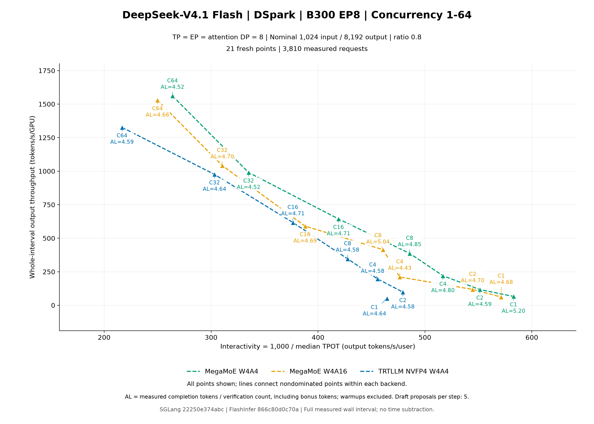
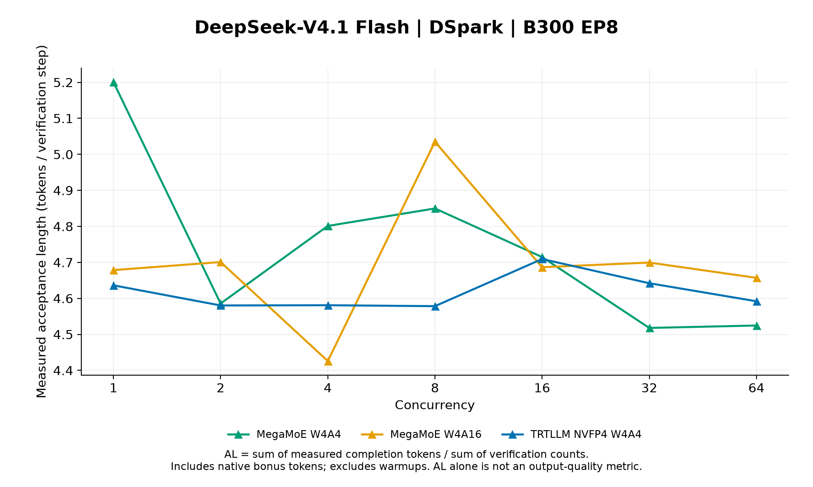

# October 10 EP8 benchmark: V4.1 complete; GLM-5.2 running

DeepSeek-V4.1 Flash with DSpark completed all 21 points: three backends at concurrency 1, 2, 4, 8, 16, 32, and 64. All 3,810 measured requests and 762 excluded warmup requests succeeded, with zero request failures and complete native speculative-counter coverage. **GLM-5.2 is running; its measurements are pending.** This interim report covers only V4.1; the final two-model report will supersede it.

The run uses one node with eight NVIDIA B300 SXM6 GPUs, TP8 / EP8 / attention DP8, and replica DP1. Each point uses 2C warmups and 10C measured requests, nominal 1,024-token inputs and 8,192-token outputs sampled at ratio 0.8, seed 0, temperature 0, and `ignore_eos=true`. DSpark proposes five draft tokens per verification, with a six-token verification window. Its native draft backend is `flashinfer_mxfp4`, with no draft all-to-all; the target and draft use the same checkpoint. See the [reusable recipe and full settings](../../README.md).

| Pin | Exact value |
| --- | --- |
| SGLang | [`22250e374abcff99e78e862da647a83b1c2ebe27`](https://github.com/zianglih/sglang/commit/22250e374abcff99e78e862da647a83b1c2ebe27); [DSpark compatibility draft #7](https://github.com/zianglih/sglang/pull/7) |
| FlashInfer Python and cubin packages | [`866c80d0c70a90624b4c2056d12d1543d709609e`](https://github.com/flashinfer-ai/flashinfer/commit/866c80d0c70a90624b4c2056d12d1543d709609e); built from source, no released FlashInfer wheels |
| Benchmark recipe | [`9d9e053d072568ecba7ad2543f3ded240d3d76f4`](https://github.com/zianglih/InferenceX/commit/9d9e053d072568ecba7ad2543f3ded240d3d76f4) |
| Image | `lmsysorg/sglang:nightly-dev-cu13-20261010-961bcf48@sha256:53efab7e8255a47b19edc81a0f1ad37cd6c8341bfe8f448d268700b182b2f03d` |
| Checkpoint | `nvidia/DeepSeek-V4.1-Flash-NVFP4@3431dde3247c13b5957f682b1e3c6fcae2566079` |
| Runtime | Python 3.12; PyTorch `2.14.1+cu130`; CUDA runtime 13.0; NVIDIA driver `590.48.01` |
| Packages | SGLang `0.0.0.dev2+g22250e374`; FlashInfer Python/cubin `0.7.2+cu130.g866c80d0c70a` |

These are fresh measurements. The first C1 point qualified each backend before its C2–C64 sweep. Every case started a new server; compile caches were shared and tactic caches were separated by model and backend. Normal startup and warmups were excluded from timing. This is a single serial sweep, not a cold-start benchmark or a repeated-trial estimate.

[Pareto plot: PNG](dsv41/figures/pareto.png) · [SVG](dsv41/figures/pareto.svg)

[Acceptance-length plot: PNG](dsv41/figures/acceptance-length.png) · [SVG](dsv41/figures/acceptance-length.svg)

[Full compact metrics JSON](dsv41/metrics.json) · [Metrics CSV](dsv41/metrics.csv) · [All signed backend comparisons](dsv41/comparisons.csv) · [Generated results summary](dsv41/RESULTS.md). The plots retain every measured point; lines denote each backend’s nondominated frontier. Green is MegaMoE W4A4, orange is MegaMoE W4A16, and blue is TRTLLM NVFP4 W4A4.

Across the complete grid, MegaMoE W4A4 has the lowest median TPOT at every concurrency and the highest throughput at C1, C4, C16, and C64. MegaMoE W4A16 has the highest throughput at C2, C8, and C32. Relative to MegaMoE W4A4, its throughput changes range from −8.34% to +7.22%, so this sweep does not show a uniform W4A16 speedup.

Against TRTLLM, MegaMoE W4A4 has higher throughput and lower median TPOT at all seven points. MegaMoE W4A16 has lower median TPOT at all seven points and higher throughput at six; C16 is the exception, with throughput 4.38% lower. Whole-interval throughput and median TPOT measure different properties, so their rankings need not agree.

W4A16 acceptance length is higher than MegaMoE W4A4 at C2, C8, C32, and C64, and lower at C1, C4, and C16. The larger DSpark draft budget does not establish a uniform acceptance-length advantage. These observations carry no statistical-significance or model-accuracy claim.

**Counter and workload definitions.** AL is the sum of measured completion tokens divided by the sum of native verification counts. It includes bonus tokens and is not the number of accepted draft tokens. Native acceptance rate is correct/proposed draft tokens, excluding bonus tokens; proposed tokens equal five times the verification count. The initial prefill token and final output-length clipping mean AL is not exactly `1 + 5 × acceptance_rate`. Warmup counters are excluded.

All three backends share the exact ordered prompt/output-budget plan at each concurrency, and the exporter verified matching ordered input/output/server-input lengths. Plans differ across concurrencies; generated text equality is not asserted. The workload is synthetic. W4A16 also affects eligible dense NVFP4 linears, so these are runtime-arm comparisons rather than an isolated MoE-only precision experiment. Acceptance measures speculative execution agreement, not output quality.

The table below retains all 21 points and exact integer native counters. Duration is the whole measured interval, including scheduling and drain. `y` is output tokens / duration / 8 GPUs; plot `x` is 1,000 / median TPOT in milliseconds. Displayed durations and derived values are rounded; the JSON/CSV retain full precision. Saved ITL in those files is chunk spacing at stream interval 30.

| C | Backend | Output tokens | Duration (s) | Verify count | Correct / proposed drafts | AL | Median TPOT (ms) | y (tokens/s/GPU) |
| ---: | --- | ---: | ---: | ---: | ---: | ---: | ---: | ---: |
| 1 | MegaMoE W4A4 | 73906 | 139.214720 | 14211 | 59718 / 71055 | 5.200619 | 1.715565 | 66.360 |
| 1 | MegaMoE W4A16 | 73906 | 149.929405 | 15797 | 58124 / 78985 | 4.678483 | 1.750135 | 61.617 |
| 1 | TRTLLM NVFP4 W4A4 | 73906 | 177.709500 | 15941 | 57976 / 79705 | 4.636221 | 2.152700 | 51.985 |
| 2 | MegaMoE W4A4 | 146066 | 155.829619 | 31852 | 114247 / 159260 | 4.585772 | 1.813434 | 117.168 |
| 2 | MegaMoE W4A16 | 146066 | 154.013125 | 31072 | 115014 / 155360 | 4.700888 | 1.835831 | 118.550 |
| 2 | TRTLLM NVFP4 W4A4 | 146066 | 185.608889 | 31890 | 114200 / 159450 | 4.580307 | 2.085955 | 98.369 |
| 4 | MegaMoE W4A4 | 290482 | 164.856205 | 60502 | 230033 / 302510 | 4.801197 | 1.934617 | 220.254 |
| 4 | MegaMoE W4A16 | 290482 | 171.914388 | 65632 | 224898 / 328160 | 4.425920 | 2.098668 | 211.211 |
| 4 | TRTLLM NVFP4 W4A4 | 290482 | 184.671079 | 63411 | 227126 / 317055 | 4.580940 | 2.193956 | 196.621 |
| 8 | MegaMoE W4A4 | 588640 | 190.058961 | 121376 | 467369 / 606880 | 4.849723 | 2.058802 | 387.143 |
| 8 | MegaMoE W4A16 | 588640 | 177.260484 | 116907 | 471845 / 584535 | 5.035113 | 2.170155 | 415.095 |
| 8 | TRTLLM NVFP4 W4A4 | 588640 | 212.373619 | 128570 | 460177 / 642850 | 4.578362 | 2.338193 | 346.465 |
| 16 | MegaMoE W4A4 | 1179927 | 229.017134 | 250266 | 929840 / 1251330 | 4.714692 | 2.385356 | 644.017 |
| 16 | MegaMoE W4A16 | 1179927 | 249.865306 | 251770 | 928360 / 1258850 | 4.686527 | 2.577350 | 590.282 |
| 16 | TRTLLM NVFP4 W4A4 | 1179927 | 238.916021 | 250555 | 929605 / 1252775 | 4.709253 | 2.655899 | 617.334 |
| 32 | MegaMoE W4A4 | 2373636 | 299.694051 | 525389 | 1848669 / 2626945 | 4.517864 | 2.984038 | 990.025 |
| 32 | MegaMoE W4A16 | 2373636 | 284.797546 | 505085 | 1869016 / 2525425 | 4.699478 | 3.221024 | 1041.808 |
| 32 | TRTLLM NVFP4 W4A4 | 2373636 | 304.057112 | 511335 | 1862679 / 2556675 | 4.642037 | 3.297927 | 975.818 |
| 64 | MegaMoE W4A4 | 4726780 | 378.590033 | 1044681 | 3682983 / 5223405 | 4.524616 | 3.789009 | 1560.653 |
| 64 | MegaMoE W4A16 | 4726780 | 386.435919 | 1014988 | 3712599 / 5074940 | 4.656981 | 4.001861 | 1528.966 |
| 64 | TRTLLM NVFP4 W4A4 | 4726780 | 445.412835 | 1029372 | 3698155 / 5146860 | 4.591907 | 4.614343 | 1326.517 |

Full server logs, per-request counter records, source-build artifacts, and caches remain in cluster persistent storage. This publication contains compact counters, provenance, and plot inputs; it does not copy the full logs to GitHub.
