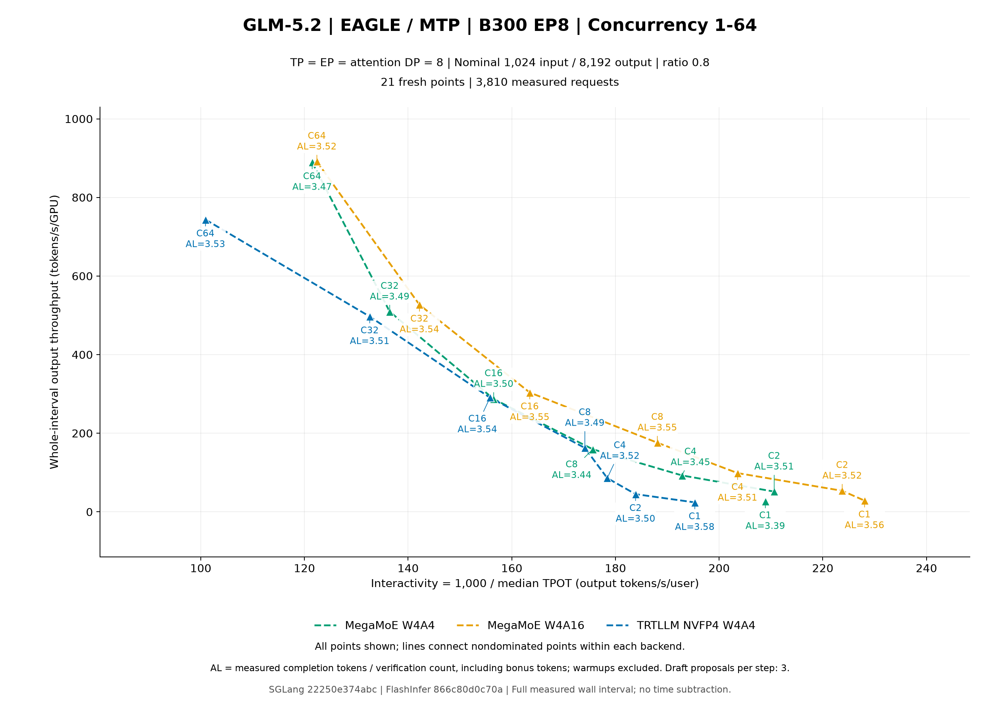
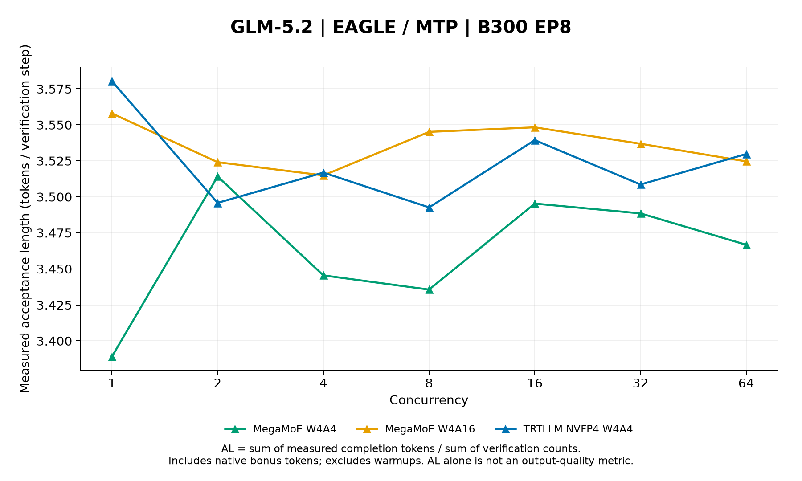

# Fresh EP8 W4A16 serving results

Run `w4a16-blog-ep8-20261010` contains 42 measured points: DeepSeek-V4.1 Flash with DSpark, then GLM-5.2 with EAGLE/MTP, each comparing MegaMoE W4A4, MegaMoE W4A16, and TRTLLM NVFP4 W4A4 at C1, C2, C4, C8, C16, C32, and C64.

All 7,620 measured requests and 1,524 warmup requests succeeded. Warmups are excluded from every reported metric. Each point uses TP8, EP8, attention-DP8, and one model replica on eight B300 GPUs.

## Source and environment

| Component | Recorded pin |
| --- | --- |
| Image | `lmsysorg/sglang:nightly-dev-cu13-20261010-961bcf48@sha256:53efab7e8255a47b19edc81a0f1ad37cd6c8341bfe8f448d268700b182b2f03d` |
| SGLang | `22250e374abcff99e78e862da647a83b1c2ebe27` |
| FlashInfer | `866c80d0c70a90624b4c2056d12d1543d709609e` |
| InferenceX recipe | `9d9e053d072568ecba7ad2543f3ded240d3d76f4` |
| PyTorch / CUDA | `2.14.1+cu130` / `13.0` |
| Source-install manifest SHA-256 | `af2099c540d8f0df2227b45111e93b794f04d75acd033ec5476e28fa4696f813` |
| Installed flashinfer-cubin | `0.7.2+cu130.g866c80d0c70a` |
| Installed flashinfer-python | `0.7.2+cu130.g866c80d0c70a` |
| Installed sglang | `0.0.0.dev2+g22250e374` |
| DeepSeek-V4.1 Flash checkpoint revision | `3431dde3247c13b5957f682b1e3c6fcae2566079` |
| GLM-5.2 checkpoint revision | `53e0691e21895a3863a606dfd12910c69eba94ab` |

FlashInfer Python and cubin packages are built from the pinned PR source; no released FlashInfer wheel or released JIT-cache provider supplies this run. SGLang uses the pinned integration plus its DSpark compatibility change. Installed versions and the installation manifest binding are retained in the compact campaign record.

## Workload and metric definitions

Nominal input/output lengths are 1,024/8,192, uniformly sampled at ratio 0.8 with seed 0. Each point has 2C warmups and 10C measured requests, temperature 0, ignore-EOS, and stream interval 30. The three arms reuse the same ordered prompt plan and token lengths at each C. Radix cache is disabled; compile caches are shared and tactic caches are separated by model and arm.

- **Throughput:** measured output tokens / whole measured wall interval / 8 GPUs, including scheduling and drain, without subtracting time.
- **Interactivity:** 1,000 / saved median request TPOT in milliseconds. TPOT uses the first-to-last completion-chunk span divided by output-token count minus one.
- **Acceptance length (AL):** measured completion-token sum / native verification-count sum, including bonus tokens. It is a ratio of totals, not an average of per-request ratios. The first prefill token emits without verification, and the final speculative run can be clipped at `max_tokens`; native AL therefore need not equal `1 + gamma * acceptance_rate`.
- **Acceptance rate:** native correct-draft sum / proposed-draft sum. All measured requests must supply counters. DSpark proposes five tokens per step; GLM's EAGLE setup proposes three.
- **ITL:** received chunk spacing at interval 30, not individual-token latency. The JSON/CSV retain TTFT, TPOT, E2EL, ITL summaries, exact totals, coverage, and measured duration.

These are fresh results. The serial prompt preparation, strict warmup-success gate, and shared HTTP connection pool are common to all arms and differ from the historical campaign. Cross-campaign changes cannot be attributed solely to the kernels. W4A16 also affects eligible NVFP4 dense linears; V4.1 retains its native mixed-precision layers and MXFP4 draft. Acceptance length measures speculative execution, not output quality. A larger draft budget does not itself establish a larger W4A16 effect, and one sweep does not establish statistical significance.

## DeepSeek-V4.1 Flash: DSpark

Prompt format: DeepSeek-V4.1 chat; reasoning_effort=None.

[Frontier SVG](dsv41/figures/pareto.svg)

[Acceptance-length SVG](dsv41/figures/acceptance-length.svg)

Green: MegaMoE W4A4; orange: MegaMoE W4A16; blue: TRTLLM NVFP4 W4A4. All 21 points are shown; frontier lines connect nondominated points within each backend.

| Backend | C | Output tok/s/GPU | Interactivity tok/s/user | AL | Acceptance rate | Completion tokens | Verify count | Correct drafts | Proposed drafts |
| --- | ---: | ---: | ---: | ---: | ---: | ---: | ---: | ---: | ---: |
| MegaMoE W4A4 | 1 | 66.360 | 582.898 | 5.2006 | 0.8404 | 73906 | 14211 | 59718 | 71055 |
| MegaMoE W4A4 | 2 | 117.168 | 551.440 | 4.5858 | 0.7174 | 146066 | 31852 | 114247 | 159260 |
| MegaMoE W4A4 | 4 | 220.254 | 516.898 | 4.8012 | 0.7604 | 290482 | 60502 | 230033 | 302510 |
| MegaMoE W4A4 | 8 | 387.143 | 485.719 | 4.8497 | 0.7701 | 588640 | 121376 | 467369 | 606880 |
| MegaMoE W4A4 | 16 | 644.017 | 419.225 | 4.7147 | 0.7431 | 1179927 | 250266 | 929840 | 1251330 |
| MegaMoE W4A4 | 32 | 990.025 | 335.116 | 4.5179 | 0.7037 | 2373636 | 525389 | 1848669 | 2626945 |
| MegaMoE W4A4 | 64 | 1560.653 | 263.921 | 4.5246 | 0.7051 | 4726780 | 1044681 | 3682983 | 5223405 |
| MegaMoE W4A16 | 1 | 61.617 | 571.384 | 4.6785 | 0.7359 | 73906 | 15797 | 58124 | 78985 |
| MegaMoE W4A16 | 2 | 118.550 | 544.713 | 4.7009 | 0.7403 | 146066 | 31072 | 115014 | 155360 |
| MegaMoE W4A16 | 4 | 211.211 | 476.493 | 4.4259 | 0.6853 | 290482 | 65632 | 224898 | 328160 |
| MegaMoE W4A16 | 8 | 415.095 | 460.797 | 5.0351 | 0.8072 | 588640 | 116907 | 471845 | 584535 |
| MegaMoE W4A16 | 16 | 590.282 | 387.995 | 4.6865 | 0.7375 | 1179927 | 251770 | 928360 | 1258850 |
| MegaMoE W4A16 | 32 | 1041.808 | 310.460 | 4.6995 | 0.7401 | 2373636 | 505085 | 1869016 | 2525425 |
| MegaMoE W4A16 | 64 | 1528.966 | 249.884 | 4.6570 | 0.7316 | 4726780 | 1014988 | 3712599 | 5074940 |
| TRTLLM NVFP4 W4A4 | 1 | 51.985 | 464.533 | 4.6362 | 0.7274 | 73906 | 15941 | 57976 | 79705 |
| TRTLLM NVFP4 W4A4 | 2 | 98.369 | 479.397 | 4.5803 | 0.7162 | 146066 | 31890 | 114200 | 159450 |
| TRTLLM NVFP4 W4A4 | 4 | 196.621 | 455.798 | 4.5809 | 0.7164 | 290482 | 63411 | 227126 | 317055 |
| TRTLLM NVFP4 W4A4 | 8 | 346.465 | 427.681 | 4.5784 | 0.7158 | 588640 | 128570 | 460177 | 642850 |
| TRTLLM NVFP4 W4A4 | 16 | 617.334 | 376.520 | 4.7093 | 0.7420 | 1179927 | 250555 | 929605 | 1252775 |
| TRTLLM NVFP4 W4A4 | 32 | 975.818 | 303.221 | 4.6420 | 0.7286 | 2373636 | 511335 | 1862679 | 2556675 |
| TRTLLM NVFP4 W4A4 | 64 | 1326.517 | 216.716 | 4.5919 | 0.7185 | 4726780 | 1029372 | 3698155 | 5146860 |

[Compact JSON](dsv41/metrics.json) · [Metrics CSV](dsv41/metrics.csv) · [All 21 signed backend comparisons](dsv41/comparisons.csv)

Metrics JSON SHA-256: `3e07b679eda714176aaa261223cd0f8b2c90d8141d1c6d1676439b974c532e12`.

## GLM-5.2: EAGLE / MTP

Prompt format: tokenizer chat template; add_generation_prompt=True.

[Frontier SVG](glm52/figures/pareto.svg)

[Acceptance-length SVG](glm52/figures/acceptance-length.svg)

Green: MegaMoE W4A4; orange: MegaMoE W4A16; blue: TRTLLM NVFP4 W4A4. All 21 points are shown; frontier lines connect nondominated points within each backend.

| Backend | C | Output tok/s/GPU | Interactivity tok/s/user | AL | Acceptance rate | Completion tokens | Verify count | Correct drafts | Proposed drafts |
| --- | ---: | ---: | ---: | ---: | ---: | ---: | ---: | ---: | ---: |
| MegaMoE W4A4 | 1 | 26.520 | 208.918 | 3.3891 | 0.7964 | 73906 | 21807 | 52103 | 65421 |
| MegaMoE W4A4 | 2 | 51.554 | 210.622 | 3.5142 | 0.8382 | 146066 | 41565 | 104515 | 124695 |
| MegaMoE W4A4 | 4 | 92.590 | 192.858 | 3.4455 | 0.8152 | 290482 | 84308 | 206190 | 252924 |
| MegaMoE W4A4 | 8 | 159.233 | 175.628 | 3.4356 | 0.8119 | 588640 | 171335 | 417341 | 514005 |
| MegaMoE W4A4 | 16 | 287.056 | 156.512 | 3.4953 | 0.8319 | 1179960 | 337582 | 842465 | 1012746 |
| MegaMoE W4A4 | 32 | 509.346 | 136.456 | 3.4885 | 0.8296 | 2373563 | 680390 | 1693342 | 2041170 |
| MegaMoE W4A4 | 64 | 889.284 | 121.494 | 3.4667 | 0.8223 | 4727285 | 1363620 | 3363939 | 4090860 |
| MegaMoE W4A16 | 1 | 28.592 | 228.053 | 3.5580 | 0.8527 | 73906 | 20772 | 53135 | 62316 |
| MegaMoE W4A16 | 2 | 53.609 | 223.746 | 3.5241 | 0.8414 | 146066 | 41448 | 104628 | 124344 |
| MegaMoE W4A16 | 4 | 98.618 | 203.560 | 3.5149 | 0.8384 | 290482 | 82643 | 207857 | 247929 |
| MegaMoE W4A16 | 8 | 175.960 | 188.084 | 3.5451 | 0.8484 | 588640 | 166042 | 422625 | 498126 |
| MegaMoE W4A16 | 16 | 303.587 | 163.470 | 3.5483 | 0.8495 | 1179960 | 332544 | 847492 | 997632 |
| MegaMoE W4A16 | 32 | 526.836 | 142.194 | 3.5369 | 0.8457 | 2373563 | 671090 | 1702638 | 2013270 |
| MegaMoE W4A16 | 64 | 891.101 | 122.404 | 3.5246 | 0.8416 | 4727285 | 1341215 | 3386323 | 4023645 |
| TRTLLM NVFP4 W4A4 | 1 | 24.050 | 195.307 | 3.5804 | 0.8602 | 73906 | 20642 | 53268 | 61926 |
| TRTLLM NVFP4 W4A4 | 2 | 45.048 | 183.877 | 3.4958 | 0.8320 | 146066 | 41783 | 104286 | 125349 |
| TRTLLM NVFP4 W4A4 | 4 | 85.810 | 178.426 | 3.5169 | 0.8390 | 290482 | 82597 | 207902 | 247791 |
| TRTLLM NVFP4 W4A4 | 8 | 162.699 | 174.095 | 3.4927 | 0.8310 | 588640 | 168535 | 420140 | 505605 |
| TRTLLM NVFP4 W4A4 | 16 | 290.586 | 155.798 | 3.5394 | 0.8465 | 1179960 | 333378 | 846637 | 1000134 |
| TRTLLM NVFP4 W4A4 | 32 | 497.029 | 132.593 | 3.5086 | 0.8363 | 2373563 | 676504 | 1697183 | 2029512 |
| TRTLLM NVFP4 W4A4 | 64 | 743.673 | 100.908 | 3.5298 | 0.8433 | 4727285 | 1339260 | 3388274 | 4017780 |

[Compact JSON](glm52/metrics.json) · [Metrics CSV](glm52/metrics.csv) · [All 21 signed backend comparisons](glm52/comparisons.csv)

Metrics JSON SHA-256: `f57baa55a8025ffe033bbb1084ab2478cd60e8e3f113aad577a86a1d5bca9c9a`.

## Reproduction and validation boundary

The compact recipe exports exact arithmetic, ordered-input/length equality, every measured point, and all signed backend comparisons. The report builder checks both 21-point tables, their CSV exports, plot coordinates, frontier membership, and successful layout replay. Rendered-image inspection remains a separate publication check; this report does not infer it from file existence. Full compressed logs, small per-request counters, prompt plans, build artifacts, and caches remain in cluster persistent storage.

This is the standalone manual recipe `experimental-w4a16-blog-b300-sglang-ep8`, not a registered shared CI-matrix configuration. The ordinary matrix validator rejects that key. Successful manual measurements do not imply CI-sweep success, eval qualification, dashboard ingestion, or merge eligibility.
