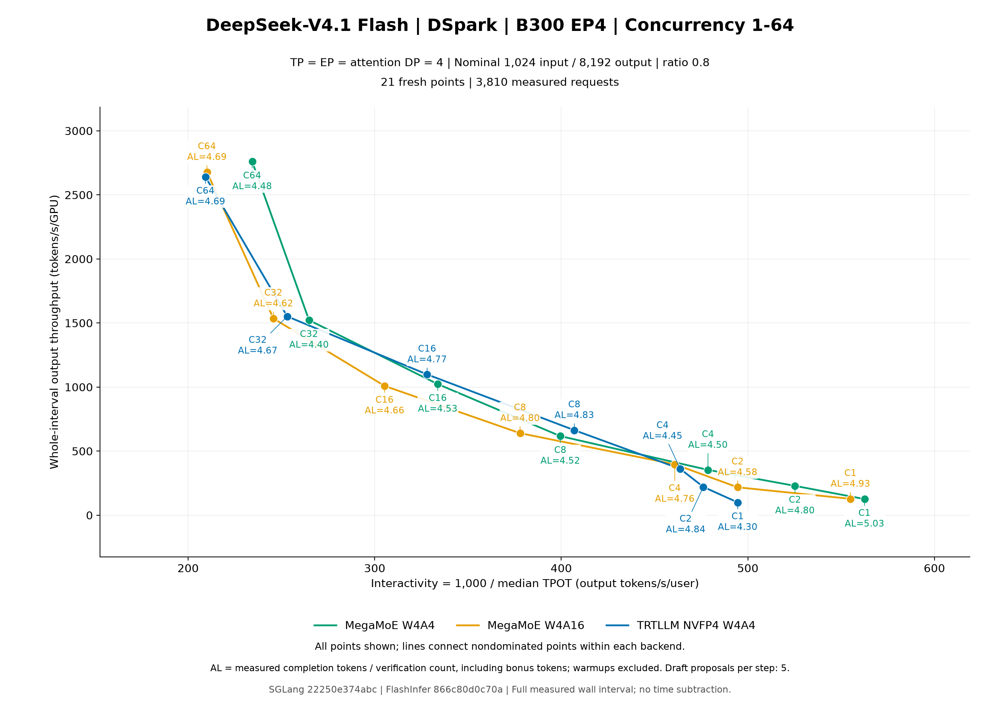
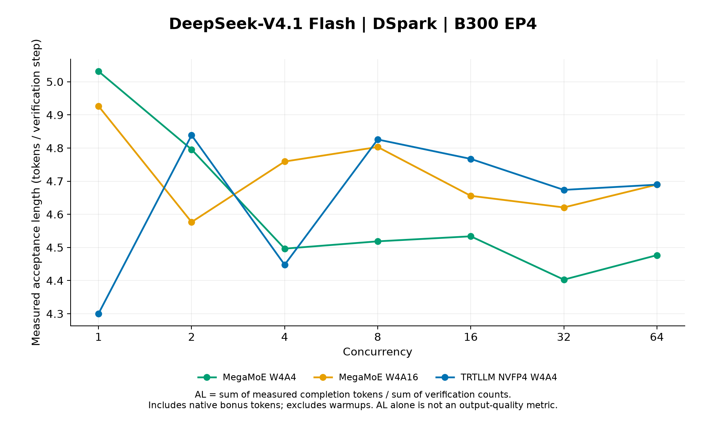

# DeepSeek-V4.1 Flash: independent DSpark EP4 series

Run `w4a16-blog-v41-ep4-gpu47-20261010` measures all 21 points independently on GPUs 4–7: MegaMoE W4A4, MegaMoE W4A16 and TRTLLM NVFP4 W4A4 at C1, 2, 4, 8, 16, 32 and 64. All 3,810 measured requests and 762 warmups passed, with zero request failures and complete native speculation counters. TP=EP=attention-DP4; throughput is divided by four. Warmups are excluded from metrics.

## Prior attempts excluded from this dataset

The earlier GPU0–3 attempt produced eight sealed points (650 measured requests and 130 warmups). Its MegaMoE W4A4 C64 server startup stalled during CUDA multicast initialization before benchmark requests; one identical retry also stalled before requests. Both attempts were stopped through controlled cleanup, and both actual inner waits returned -2. These two unmeasured startup failures and the eight original measurements are preserved on Weka and excluded from every plot point and total in this report.

This fresh series reran all 21 points on GPUs 4–7 with unchanged software, installation, checkpoint and workload settings, using fresh run and owned-TMP namespaces under the unchanged pinned runner. No cache/runner monkeypatch is used. No original point is substituted or merged. The new actual inner wait returned 0 and its processes were quiescent with the whole node GPU-idle. There is no outer wait receipt. Selecting another GPU group does not establish the cause of the previous startup stalls, and standalone diagnostic timings are not benchmark data.

Finalization receipt SHA-256: `f1ab91b8031e593a7c12c1b2f131749223ca32be2d826523987f9f5c25f9c62e`. Full logs and the exact retained prior-history manifest stay on cluster persistent storage.

## Pinned source and workload

| Component | EP4 | EP8 reference |
| --- | --- | --- |
| Run | `w4a16-blog-v41-ep4-gpu47-20261010` | `w4a16-blog-ep8-20261010` |
| Physical node | `hu-pdx-98` | `hu-pdx-42` |
| Selected GPUs / normalizer | 4, 5, 6, 7 / 4 | 0–7 / 8 |
| Image | `lmsysorg/sglang:nightly-dev-cu13-20261010-961bcf48@sha256:53efab7e8255a47b19edc81a0f1ad37cd6c8341bfe8f448d268700b182b2f03d` | Same |
| SGLang | `22250e374abcff99e78e862da647a83b1c2ebe27` | Same |
| FlashInfer | `866c80d0c70a90624b4c2056d12d1543d709609e` | Same |
| Checkpoint | `3431dde3247c13b5957f682b1e3c6fcae2566079` | Same |
| Recipe | `6b4c2af72f87a9a6d65a841bea8f9cb3107d954f` | `9d9e053d072568ecba7ad2543f3ded240d3d76f4` |
| Installation manifest SHA-256 | `e313bf24ea08a0edb45087a09a76bcb379b7a6a27c2797594d77a6293fb6650f` | `af2099c540d8f0df2227b45111e93b794f04d75acd033ec5476e28fa4696f813` |
| PyTorch / CUDA | `2.14.1+cu130` / `13.0` | Same |
| Installed flashinfer-cubin | `0.7.2+cu130.g866c80d0c70a` | Same |
| Installed flashinfer-python | `0.7.2+cu130.g866c80d0c70a` | Same |
| Installed sglang | `0.0.0.dev2+g22250e374` | Same |

Source-built FlashInfer Python/cubin and SGLang packages are reused; released FlashInfer wheels are not substituted. The cubin package uses the pinned artifact catalog; this does not mean every bundled cubin was locally compiled from PR source. JIT compilation uses the pinned PR source. The workload is nominal 1,024 input / 8,192 output tokens, ratio 0.8, seed 0, 2C warmups, 10C measurements, temperature 0, ignore-EOS, stream interval 30, radix cache disabled, and DSpark block size 5 with DP LM head and native MXFP4 draft. Prompt format: DeepSeek-V4.1 chat; reasoning_effort=None. Ordered plans and token-length digests match across all arms and the EP8 reference at each C. The unchanged global 32,768-token prefill budget is 8,192 per DP4 rank versus 4,096 per DP8 rank.

## EP4 measurements

[Pareto SVG](figures/pareto.svg)

[Acceptance-length SVG](figures/acceptance-length.svg)

Green: MegaMoE W4A4; orange: MegaMoE W4A16; blue: TRTLLM W4A4. All 21 points remain visible; solid lines join each backend's nondominated points, with circle markers.

| Backend | C | Output tok/s/GPU | Median TPOT ms | AL | Acceptance rate | Completion tokens | Verify count | Correct drafts | Proposed drafts |
| --- | ---: | ---: | ---: | ---: | ---: | ---: | ---: | ---: | ---: |
| MegaMoE W4A4 | 1 | 126.024 | 1.7776 | 5.0314 | 0.8065 | 73906 | 14689 | 59236 | 73445 |
| MegaMoE W4A4 | 2 | 228.917 | 1.9038 | 4.7957 | 0.7594 | 146066 | 30458 | 115643 | 152290 |
| MegaMoE W4A4 | 4 | 353.717 | 2.0893 | 4.4963 | 0.6994 | 290482 | 64604 | 225926 | 323020 |
| MegaMoE W4A4 | 8 | 617.228 | 2.5031 | 4.5184 | 0.7038 | 588640 | 130276 | 458460 | 651380 |
| MegaMoE W4A4 | 16 | 1023.140 | 2.9957 | 4.5336 | 0.7069 | 1179927 | 260264 | 919855 | 1301320 |
| MegaMoE W4A4 | 32 | 1522.363 | 3.7763 | 4.4028 | 0.6807 | 2373636 | 539118 | 1834946 | 2695590 |
| MegaMoE W4A4 | 64 | 2759.638 | 4.2673 | 4.4766 | 0.6955 | 4726780 | 1055883 | 3671721 | 5279415 |
| MegaMoE W4A16 | 1 | 127.877 | 1.8018 | 4.9264 | 0.7855 | 73906 | 15002 | 58918 | 75010 |
| MegaMoE W4A16 | 2 | 217.784 | 2.0222 | 4.5766 | 0.7155 | 146066 | 31916 | 114173 | 159580 |
| MegaMoE W4A16 | 4 | 397.228 | 2.1700 | 4.7592 | 0.7521 | 290482 | 61036 | 229512 | 305180 |
| MegaMoE W4A16 | 8 | 640.123 | 2.6461 | 4.8031 | 0.7608 | 588640 | 122555 | 466207 | 612775 |
| MegaMoE W4A16 | 16 | 1009.060 | 3.2755 | 4.6558 | 0.7313 | 1179927 | 253434 | 926662 | 1267170 |
| MegaMoE W4A16 | 32 | 1535.186 | 4.0698 | 4.6206 | 0.7243 | 2373636 | 513702 | 1860382 | 2568510 |
| MegaMoE W4A16 | 64 | 2678.316 | 4.7597 | 4.6894 | 0.7381 | 4726780 | 1007962 | 3719674 | 5039810 |
| TRTLLM NVFP4 W4A4 | 1 | 99.916 | 2.0220 | 4.3004 | 0.6602 | 73906 | 17186 | 56733 | 85930 |
| TRTLLM NVFP4 W4A4 | 2 | 220.742 | 2.1002 | 4.8385 | 0.7678 | 146066 | 30188 | 115896 | 150940 |
| TRTLLM NVFP4 W4A4 | 4 | 361.681 | 2.1562 | 4.4477 | 0.6897 | 290482 | 65310 | 225221 | 326550 |
| TRTLLM NVFP4 W4A4 | 8 | 663.483 | 2.4569 | 4.8257 | 0.7653 | 588640 | 121979 | 466760 | 609895 |
| TRTLLM NVFP4 W4A4 | 16 | 1098.623 | 3.0477 | 4.7671 | 0.7536 | 1179927 | 247513 | 932633 | 1237565 |
| TRTLLM NVFP4 W4A4 | 32 | 1551.622 | 3.9508 | 4.6736 | 0.7349 | 2373636 | 507879 | 1866152 | 2539395 |
| TRTLLM NVFP4 W4A4 | 64 | 2640.574 | 4.7781 | 4.6894 | 0.7381 | 4726780 | 1007968 | 3719685 | 5039840 |

[Metrics JSON](metrics.json) · [Metrics CSV](metrics.csv) · [All 21 signed backend comparisons](comparisons.csv)

## Matched-C EP4 versus EP8

Percent changes are `100 × (EP4 / EP8 − 1)`; negative TPOT means lower latency. AL changes are EP4 minus EP8. Total throughput is shown alongside per-GPU throughput because their denominators differ. These single-pass runs used different physical nodes; differences combine topology, per-rank workload and possible node/run variation. They do not isolate causal scaling effects or establish statistical significance.

| Backend | C | Per-GPU throughput change | Total throughput change | Median TPOT change | AL change |
| --- | ---: | ---: | ---: | ---: | ---: |
| MegaMoE W4A4 | 1 | +89.91% | -5.04% | +3.62% | -0.1692 |
| MegaMoE W4A4 | 2 | +95.38% | -2.31% | +4.98% | +0.2099 |
| MegaMoE W4A4 | 4 | +60.59% | -19.70% | +7.99% | -0.3048 |
| MegaMoE W4A4 | 8 | +59.43% | -20.28% | +21.58% | -0.3313 |
| MegaMoE W4A4 | 16 | +58.87% | -20.57% | +25.59% | -0.1811 |
| MegaMoE W4A4 | 32 | +53.77% | -23.11% | +26.55% | -0.1151 |
| MegaMoE W4A4 | 64 | +76.83% | -11.59% | +12.62% | -0.0480 |
| MegaMoE W4A16 | 1 | +107.53% | +3.77% | +2.95% | +0.2479 |
| MegaMoE W4A16 | 2 | +83.71% | -8.15% | +10.15% | -0.1243 |
| MegaMoE W4A16 | 4 | +88.07% | -5.96% | +3.40% | +0.3333 |
| MegaMoE W4A16 | 8 | +54.21% | -22.89% | +21.93% | -0.2320 |
| MegaMoE W4A16 | 16 | +70.95% | -14.53% | +27.09% | -0.0308 |
| MegaMoE W4A16 | 32 | +47.36% | -26.32% | +26.35% | -0.0788 |
| MegaMoE W4A16 | 64 | +75.17% | -12.41% | +18.94% | +0.0325 |
| TRTLLM NVFP4 W4A4 | 1 | +92.20% | -3.90% | -6.07% | -0.3359 |
| TRTLLM NVFP4 W4A4 | 2 | +124.40% | +12.20% | +0.68% | +0.2582 |
| TRTLLM NVFP4 W4A4 | 4 | +83.95% | -8.03% | -1.72% | -0.1332 |
| TRTLLM NVFP4 W4A4 | 8 | +91.50% | -4.25% | +5.08% | +0.2474 |
| TRTLLM NVFP4 W4A4 | 16 | +77.96% | -11.02% | +14.75% | +0.0579 |
| TRTLLM NVFP4 W4A4 | 32 | +59.01% | -20.50% | +19.80% | +0.0316 |
| TRTLLM NVFP4 W4A4 | 64 | +99.06% | -0.47% | +3.55% | +0.0975 |

[Exact topology comparison CSV](ep4-vs-ep8.csv) · [Unchanged EP8 reference](../dsv41/metrics.json)

## Metric and validation boundaries

Throughput is output tokens over the whole measured wall interval, including scheduling and drain, divided by four; no time is subtracted. Interactivity is 1,000 / median request TPOT(ms). ITL is chunk spacing at stream interval 30. Native AL is emitted completion tokens / verification count, including bonus tokens. Acceptance rate is correct / proposed draft tokens. The initial prefill token emits without verification and the final chunk can be clipped at max_tokens, so AL need not equal `1 + 5 × acceptance_rate`. AL is not an output-quality result. W4A16 also affects eligible dense NVFP4 linears; other native mixed-precision layers are retained.

Compact collection hashes, CSV math, all plot coordinates/frontiers, and same-C identities are checked. The finalization receipt binds all new case bytes and preserved excluded history. Visual inspection, public readback and fresh release ownership/retention checks remain separate gates. Full logs, request records and build/cache evidence stay on Weka. The standard matrix validator actually rejects the unregistered `experimental-w4a16-blog-b300-sglang-ep4` key; no CI-sweep success or evaluation qualification is claimed.

EP4 metrics SHA-256: `ddb0b36e26211b50209d23efa3c5c032883916d6f5c221c32a8cd56792c0b251`.

EP8 metrics SHA-256: `3e07b679eda714176aaa261223cd0f8b2c90d8141d1c6d1676439b974c532e12`.
